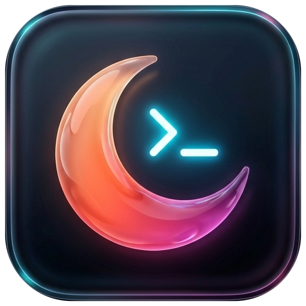

<p align="center">
  
</p>

<h1 align="center">🌙 Lunula Terminal</h1>

<p align="center">
  <strong>Ultra-Lightweight GPU-Accelerated Terminal Emulator with Elastic Wobble Physics & Built-in Developer Suite</strong>
</p>

<p align="center">
  
  
  
  
  
  
</p>

---

**Lunula Terminal** is an ultra-lightweight, high-performance GPU terminal emulator built with Rust, `wgpu`, and `glyphon`. Designed around the core philosophy of minimalism, speed, and expressive physics, Lunula delivers zero-latency sub-pixel rendering and an interactive 2D spring-damper *jelly wobble* window effect. 

The entire developer suite—including the terminal, built-in modal text editor (**luna**), 3D ASCII system fetcher (**lfetch**), terminal image viewer (**limg**), and theme manager (**lpm**)—compiles into standalone executables under 12 MB total, with zero runtime dependencies.

---

## 💎 Key Features

* ⚡ **GPU-Accelerated Text Pipeline**: Direct WGPU render pass utilizing Glyphon for crisp sub-pixel font rasterization at 120/144Hz with zero allocations during active typing.
* 🍮 **Elastic Jelly Wobble Physics**: Real-time 2D mass-spring-damper mesh physics that responds to window movements and dragging, bringing tactile life back to the developer desktop.
* 🪟 **Tiling Binary Split Panes & Tabs**: Arbitrary vertical and horizontal splits with direction-aware keyboard navigation (`Alt + Arrows`), multi-tab support, and synchronized screen updates.
* ⚙️ **Hot-Reloadable Lua Ecosystem**: Modular configuration powered by Lua 5.4 that reloads automatically the instant you save:
  * [`lunula.lua`](file:///e:/My%20Projects/lunula_terminal/lunula.lua) — Master configuration (Window, Physics, Font, Shell).
  * [`colors.lua`](file:///e:/My%20Projects/lunula_terminal/colors.lua) — 16 ANSI palette colors and UI theme overrides.
  * [`keybinds.lua`](file:///e:/My%20Projects/lunula_terminal/keybinds.lua) — Fully dynamic custom keyboard shortcut mappings.
* 🌙 **Built-in Modal Code Editor (`luna`)**: Ultra-fast nano/vim-inspired text editor (<400 KB) featuring lexical syntax highlighting for Rust, Lua, Python, JavaScript/TypeScript, Go, and JSON.
* 🔍 **Alacritty-Style Vi Navigation & Regex Hints**: Keyboard-driven scrollback buffer navigation, visual character and line selection, text yanking, and instant scanning for URLs, hashes, and file paths (`Ctrl+Shift+U`).
* 🖼️ **Kitty Graphics Protocol**: High-performance inline terminal graphics rendering via the companion utility `limg`.
* 🛡️ **Zero External Runtime Dependencies**: Standalone binaries without requiring external frameworks, runtimes, or heavy web engines.

---

## 🚀 Installation & Quick Start

### Option 1: Standalone Release Package (Recommended)
Download the latest release archive from [GitHub Releases](https://github.com/lunula-terminal/releases) or use the bundle located in [dist/](file:///e:/My%20Projects/lunula_terminal/dist/):

1. Download and extract `lunula-terminal-v0.1.0-windows-x86_64.zip`.
2. **Automated Setup**: Double-click `install.bat`.
   * Installs Lunula Suite to `%LOCALAPPDATA%\Programs\Lunula\bin`.
   * Registers `lunula`, `luna`, `lfetch`, `limg`, and `lpm` to your Windows `PATH`.
   * Automatically registers in **Windows Settings $\rightarrow$ Apps $\rightarrow$ Installed apps** for clean uninstallation.
   * Creates Start Menu and Desktop shortcuts with the official app icon.
3. **Portable Mode**: Prefer no installation? Simply double-click `Lunula.bat` (or run `bin\lunula.exe`) directly from anywhere (USB drive, custom directory)!

### Option 2: Build From Source
Ensure you have the Rust stable toolchain installed:

```bash
# Clone the repository
git clone https://github.com/lunula-terminal/lunula_terminal.git
cd lunula_terminal

# Run unit test suite (49 passing)
cargo test

# Build all release binaries with full link-time optimization (LTO)
cargo build --release

# Launch Lunula Terminal
./target/release/lunula.exe
```

---

## 🧰 Included CLI Companion Tools

| Executable | Size | Description & Role |
| :--- | :--- | :--- |
| **`lunula.exe`** | ~9.6 MB | Main GPU terminal emulator with ConPTY and wobble physics |
| **`luna.exe`** | ~400 KB | Fast modal text editor with syntax highlighting |
| **`lfetch.exe`** | ~800 KB | System fetch utility with 3D raymarched moon animation |
| **`limg.exe`** | ~330 KB | High-performance inline Kitty Graphics image viewer |
| **`lpm.exe`** | ~430 KB | Package and theme manager for custom color palettes |

---

## ⌨️ Default Keyboard Shortcuts

| Shortcut | Action / Description |
| :--- | :--- |
| `Ctrl + Shift + T` | Open a new Tab |
| `Ctrl + Tab` / `Ctrl + Shift + Tab` | Switch to Next / Previous Tab |
| `Ctrl + 1..9` | Jump directly to Tab 1 through 9 |
| `Ctrl + Shift + E` | Split Active Pane Vertically (side-by-side) |
| `Ctrl + Shift + D` | Split Active Pane Horizontally (top / bottom) |
| `Alt + Arrows (← ↑ → ↓)` | Navigate focus between split panes |
| `Ctrl + Shift + W` | Close active split pane (or active tab if last) |
| `Ctrl + C` / `Ctrl + Shift + C` | Copy selection (or send `SIGINT` if no selection) |
| `Ctrl + V` / `Right-Click` | Paste clipboard text into active terminal |
| `Ctrl + Shift + F` | Quick Search across scrollback buffer |
| `Ctrl + Shift + Space` | Toggle **Vi Navigation Mode** |
| `Ctrl + Shift + U` | Scan and highlight **Regex Hints** (URLs, file paths, git hashes) |
| `Ctrl + ,` / `Gear Button ⚙️` | Open **Settings & Configuration Hub** |
| `Shift + F1` / `Question Mark ?` | Open **Shortcuts & Features Reference** |
| `Ctrl + Shift + R` | Hot-reload configuration (`lunula.lua`) |
| `Ctrl + Shift + P` | Reload PowerShell profile (`. $PROFILE`) |
| `F11` | Toggle Fullscreen / Maximize window |

> [!TIP]
> All keybindings above can be customized dynamically in [`keybinds.lua`](file:///e:/My%20Projects/lunula_terminal/keybinds.lua). Changes are hot-reloaded immediately and reflected in the Help Modal overlay!

---

## 📚 Detailed Documentation (`docs/`)

Explore in-depth architectural and usage guides in the [`docs/`](file:///e:/My%20Projects/lunula_terminal/docs/) directory:

* ⚙️ **[Configuration Guide (CONFIGURATION.md)](file:///e:/My%20Projects/lunula_terminal/docs/CONFIGURATION.md)**: Lua parameters, physics calibration, and custom theme creation.
* ⌨️ **[Keybindings & Navigation (KEYBINDINGS.md)](file:///e:/My%20Projects/lunula_terminal/docs/KEYBINDINGS.md)**: Detailed cheat sheet for Vi mode, regex hints, and custom hotkeys.
* 🌙 **[Luna Editor Manual (LUNA_EDITOR.md)](file:///e:/My%20Projects/lunula_terminal/docs/LUNA_EDITOR.md)**: Editing controls, search, Git editor integration, and syntax parser.
* 🧰 **[CLI Companions Guide (CLI_COMPANIONS.md)](file:///e:/My%20Projects/lunula_terminal/docs/CLI_COMPANIONS.md)**: Manual for `lfetch`, `limg`, and `lpm`.
* 🔍 **[Troubleshooting Guide (TROUBLESHOOTING.md)](file:///e:/My%20Projects/lunula_terminal/docs/TROUBLESHOOTING.md)**: Font glyph troubleshooting, GPU battery profiles, and diagnostics.
* 🏗️ **[Technical Architecture (ARCHITECTURE.md)](file:///e:/My%20Projects/lunula_terminal/docs/ARCHITECTURE.md)**: Module architecture, WGPU data flow, and Windows ConPTY integration.
* ⚡ **[Performance & Memory Optimizations (OPTIMIZATIONS.md)](file:///e:/My%20Projects/lunula_terminal/docs/OPTIMIZATIONS.md)**: 7 technical strategies behind zero-allocation render passes and memory footprint.

---

## 🏛️ Core Principles (`principle.md`)

```text
"ultra-lightweight terminal, highly customisable, single executable,
 no dependencies, focus on speed, minimalism, animation"
```

1. **Maximum Speed**: Sub-millisecond input latency with direct GPU hardware acceleration.
2. **Modular Customizability**: Complete user control over aesthetics, colors, keybindings, and physics via Lua.
3. **Single Self-Contained Binary**: Zero external runtime requirements; run directly anywhere.
4. **Distinct Aesthetic Identity**: Combining serious developer terminal capabilities with modern physical animation.

---

## 📄 License

Distributed under the MIT / Apache-2.0 License. Free to use, modify, and distribute.
Crafted with ❤️ for developers and terminal enthusiasts.
